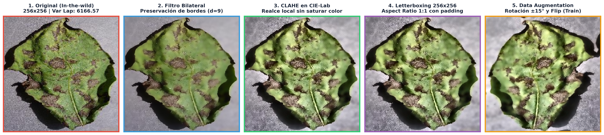
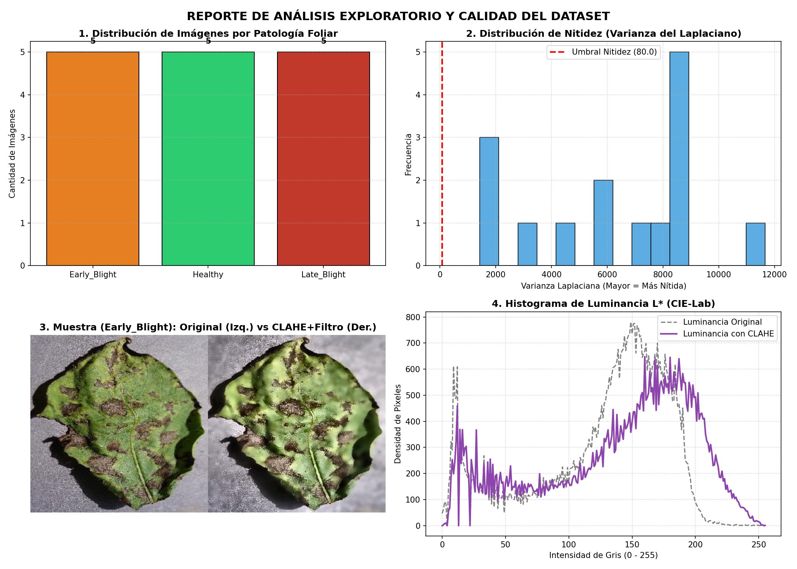

<div align="center">

# Preprocesamiento de Dataset de Patologías Foliares en el Cultivo de Papa (*Solanum tuberosum*) mediante Visión Artificial

[](https://www.python.org/)
[](https://opensource.org/licenses/MIT)
[](https://opencv.org/)
[](#)
[](https://github.com/psf/black)

**Universidad Nacional de San Antonio Abad del Cusco (UNSAAC)**  
*Facultad de Ingeniería Eléctrica, Electrónica, Informática y Mecánica*  
*Escuela Profesional de Ingeniería Informática y de Sistemas*  
**Asignatura:** Visión Computacional (IF657BIN) — Semestre 2026-2

</div>

---

## 📋 Tabla de Contenidos
- [1. Descripción y Justificación del Proyecto](#1-descripción-y-justificación-del-proyecto)
- [2. Desafíos en Visión por Computador](#2-desafíos-en-visión-por-computador)
- [3. Pipeline de Preprocesamiento](#3-pipeline-de-preprocesamiento)
- [4. Análisis Exploratorio de Datos (EDA) y Auditoría de Calidad](#4-análisis-exploratorio-de-datos-eda-y-auditoría-de-calidad)
- [5. Estructura del Repositorio](#5-estructura-del-repositorio)
- [6. Instalación y Requisitos](#6-instalación-y-requisitos)
- [7. Guía de Ejecución y Reproducibilidad](#7-guía-de-ejecución-y-reproducibilidad)
- [8. Pruebas Unitarias](#8-pruebas-unitarias)
- [9. Documentación y Entregables](#9-documentación-y-entregables)
- [10. Autores y Créditos](#10-autores-y-créditos)
- [11. Licencia](#11-licencia)

---

## 1. Descripción y Justificación del Proyecto

El cultivo de la papa (*Solanum tuberosum*) constituye la base socioeconómica y alimentaria fundamental de la región del Cusco y de los Andes peruanos. No obstante, su rendimiento agrícola se encuentra constantemente amenazado por afecciones criptogámicas de severo impacto:

1. **Tizón Temprano (*Early Blight*):** Enfermedad causada por el hongo fitopatógeno *Alternaria solani*, caracterizada por manchas necróticas marrones con círculos concéntricos en patrón de "diana" y halos cloróticos.
2. **Tizón Tardío (*Late Blight*):** Ocasionado por el oomiceto *Phytophthora infestans*, patógeno histórico causante de lesiones foliares acuosas verde oscuras a negras de propagación explosiva que necrosan completamente el follaje.
3. **Follaje Sano (*Healthy*):** Tejido foliar libre de lesiones necróticas que exhibe coloraciones verdes y texturas fisiológicas normales.

Este proyecto implementa una solución integral de ingeniería de datos y visión por computador orientada a auditar, limpiar, estandarizar y enriquecer el dataset de imágenes foliares para servir como entrada de alta calidad a modelos de Deep Learning y Redes Neuronales Convolucionales (CNN).

---

## 2. Desafíos en Visión por Computador

A diferencia de los bancos de datos capturados en laboratorios bajo fondos blancos homogéneos, las capturas agrícolas en condiciones reales (*in-the-wild*) introducen complejidades significativas:

* **Variabilidad Fotométrica:** Radiación solar cenital directa, zonas de sombra profunda y reflejos especulares causados por la cutícula cerosa de las hojas.
* **Fondos Complejos No Estructurados:** Presencia de suelo húmedo, rastrojo, tallos, sombras y superposición entre hojas del dosel vegetal.
* **Similitud Inter-Clase en Fases Iniciales:** Las microlesiones prematuras de *Alternaria solani* y *Phytophthora infestans* comparten tonalidades pardas y morfologías indistinguibles a simple vista antes de la maduración de los anillos concéntricos.
* **Escalas y Ángulos Arbitrarios:** Variación continua en la distancia focal del sensor y la perspectiva angular de captura.

---

## 3. Pipeline de Preprocesamiento

El pipeline diseñado e implementado en `src/` ejecuta una secuencia determinista orientada a preservar la información semántica y eliminar artefactos no deseados:

<div align="center">
  
  <p><em>Figura 1: Transformación secuencial de una imagen foliar a lo largo de las fases del pipeline.</em></p>
</div>

### Fases de Procesamiento:

1. **Auditoría de Desenfoque y Nitidez:**
   * Evaluación de la respuesta del operador Laplaciano discreto:
     $$\text{Var}(\nabla^2 I) = \frac{1}{N} \sum_{x,y} \left( \nabla^2 I(x, y) - \mu \right)^2$$
   * Filtra automáticamente capturas movidas o desenfocadas por debajo de un umbral calibrado ($\sigma^2 < 80.0$).
2. **Filtrado Espacial Bilateral:**
   * Atenúa el ruido de alta frecuencia del sensor fotográfico conservando con precisión subpíxel los gradientes y bordes finos de las pústulas necróticas:
     $$I^{\text{filtered}}(p) = \frac{1}{W_p} \sum_{q \in S} I(q) \, G_{\sigma_s}(\|p - q\|) \, G_{\sigma_r}(\|I(p) - I(q)\|)$$
3. **Realce Adaptativo de Contraste Local (CLAHE en CIE-Lab):**
   * Desacopla la luminancia de la crominancia. Transforma de BGR al espacio perceptual CIE-Lab y aplica CLAHE exclusivamente sobre el canal de Luminancia ($L^*$) con límite de recorte `clipLimit=2.5` y teselas de $8 \times 8$, evitando la saturación irreal de la clorofila vegetal.
4. **Estandarización Espacial con Letterbox:**
   * Escala isotrópicamente a resolución fija ($256 \times 256$ píxeles) rellenando con bordes simétricos constantes, preservando la relación de aspecto original (Aspect Ratio 1:1) y evitando deformaciones anatómicas en la morfología foliar.
5. **Aumento de Datos Controlado (*Data Augmentation*):**
   * Aplicado exclusivamente sobre el conjunto de entrenamiento (`train`) mediante rotaciones controladas ($\pm 15^\circ$), volteo horizontal simétrico y microajustes de brillo/contraste para prevenir el sobreajuste (*overfitting*).

---

## 4. Análisis Exploratorio de Datos (EDA) y Auditoría de Calidad

<div align="center">
  
  <p><em>Figura 2: Dashboard analítico de distribución de clases, métricas de nitidez y espectro cromático.</em></p>
</div>

* **Balanceo y Distribución:** Particionado estratificado en proporciones estándar para Machine Learning:
  * **Train (70%):** Enriquecido con data augmentation.
  * **Validation (15%):** Muestras intactas para ajuste de hiperparámetros.
  * **Test (15%):** Muestras intactas para evaluación de generalización sin sesgos optimistas.
* **Metadatos Estadísticos:** Cada ejecución del pipeline serializa de forma transparente un resumen estructurado en `data_processed/metadata_preprocesamiento.json`.

---

## 5. Estructura del Repositorio

El proyecto sigue una arquitectura limpia y modular desacoplada:

```text
procesamiento-dataset-patologias-foliares/
├── .github/
│   └── workflows/
│       └── ci.yml                            # Flujo de Integración Continua (CI)
├── assets/
│   ├── pipeline_comparativa.png              # Infografía del pipeline para documentación
│   └── eda_report.png                        # Reporte visual del Análisis Exploratorio de Datos
├── data_raw/                                 # Muestras crudas iniciales organizadas por clase
│   ├── Early_Blight/                         # Tizón Temprano (Alternaria solani)
│   ├── Healthy/                              # Follaje Sano
│   ├── Late_Blight/                          # Tizón Tardío (Phytophthora infestans)
│   └── README.md                             # Documentación del dataset de entrada
├── data_processed/                           # Directorio destino de datos particionados
│   ├── .gitkeep                              # Control de versiones del directorio
│   └── metadata_preprocesamiento.json        # Metadatos del particionado
├── docs/                                     # Informes técnicos, presentaciones y artículos
│   ├── informe_preprocesamiento.pdf          # Informe oficial compilado en formato PDF
│   ├── informe_preprocesamiento.tex          # Código fuente en LaTeX (formato UNSAAC)
│   ├── informe_preprocesamiento.html         # Versión interactiva para navegador
│   ├── diapositivas_exposicion.pdf           # Presentación en diapositivas (PDF)
│   ├── diapositivas_exposicion.tex           # Fuente LaTeX Beamer de la presentación
│   └── diapositivas_exposicion.html          # Diapositivas web interactivas
├── notebooks/
│   └── Primera_Entrega_Preprocesamiento_Dataset.ipynb  # Cuaderno interactivo (Colab/Jupyter)
├── src/                                      # Código fuente modular
│   ├── __init__.py                           # Exportaciones del paquete
│   ├── preprocesamiento.py                   # Algoritmos de visión computacional y filtrado
│   ├── pipeline.py                           # Orquestador del pipeline por lotes
│   ├── analisis_eda.py                       # Generador de gráficos analíticos
│   └── generar_figura_pipeline.py            # Generador de infografía comparativa
├── tests/
│   ├── __init__.py
│   └── test_preprocesamiento.py              # Suite de pruebas unitarias (unittest)
├── .gitattributes                            # Normalización de fines de línea y binarios
├── .gitignore                                # Exclusión de temporales, cachés y artefactos
├── LICENSE                                   # Licencia abierta MIT
├── pyproject.toml                            # Configuración estándar del paquete Python
├── README.md                                 # Documentación principal del repositorio
└── requirements.txt                          # Dependencias reproducibles
```

---

## 6. Instalación y Requisitos

### Requisitos Previos
* Python 3.9 o superior.
* Gestor de paquetes `pip` y entorno virtual (`venv` recomendado).

### Pasos de Instalación

1. **Clonar el repositorio:**
   ```bash
   git clone https://github.com/YefersonSupa/procesamiento-dataset-patologias-foliares.git
   cd procesamiento-dataset-patologias-foliares
   ```

2. **Crear y activar un entorno virtual:**
   ```bash
   # En Windows:
   python -m venv venv
   .\venv\Scripts\activate

   # En Linux / macOS:
   python3 -m venv venv
   source venv/bin/activate
   ```

3. **Instalar dependencias:**
   ```bash
   pip install --upgrade pip
   pip install -r requirements.txt
   ```

---

## 7. Guía de Ejecución y Reproducibilidad

### 7.1. Ejecutar el Pipeline de Procesamiento Completo
Procesa todas las imágenes de `data_raw/`, aplica auditoría, filtrado bilateral, CLAHE, letterboxing y genera las particiones `train`, `val` y `test` en `data_processed/`:
```bash
python src/pipeline.py
```

### 7.2. Generar el Reporte de Análisis Exploratorio (EDA)
Genera el panel de 4 cuadrantes con distribución, métricas de nitidez y gráficos cromáticos:
```bash
python src/analisis_eda.py
```

### 7.3. Generar la Comparativa Visual del Pipeline
Crea la figura comparativa de etapas `assets/pipeline_comparativa.png`:
```bash
python src/generar_figura_pipeline.py
```

### 7.4. Cuaderno Interactivo (Jupyter / Google Colab)
Para una exploración interactiva paso a paso con visualizaciones intermedias:
```bash
jupyter notebook notebooks/Primera_Entrega_Preprocesamiento_Dataset.ipynb
```
O ábralo directamente en Google Colab cargando el archivo desde la carpeta `notebooks/`.

---

## 8. Pruebas Unitarias

El proyecto cuenta con una suite completa de pruebas unitarias para asegurar la estabilidad algorítmica:
```bash
python -m unittest discover -s tests -v
```

Cobertura de pruebas:
- `test_auditar_calidad_valida` y `test_auditar_calidad_invalida`
- `test_redimensionar_letterbox_cuadrado` y `test_redimensionar_letterbox_relacion_aspecto`
- `test_reducir_ruido_bilateral`
- `test_realzar_contraste_clahe_lab`
- `test_segmentar_hoja_hsv`
- `test_aplicar_data_augmentation`
- `test_pipeline_completo_preprocesamiento`

---

## 9. Documentación y Entregables

Toda la documentación académica e institucional se encuentra consolidada en el directorio [`docs/`](./docs/):
* **Informe Técnico Oficial:** [`docs/informe_preprocesamiento.pdf`](./docs/informe_preprocesamiento.pdf) (Compilado con carátula institucional de la UNSAAC).
* **Diapositivas de Exposición:** [`docs/diapositivas_exposicion.pdf`](./docs/diapositivas_exposicion.pdf) (Formato presentación ejecutiva de 3 a 5 minutos).
* **Versiones Web Interactivas:** Disponibles en [`docs/informe_preprocesamiento.html`](./docs/informe_preprocesamiento.html) y [`docs/diapositivas_exposicion.html`](./docs/diapositivas_exposicion.html).

---

## 10. Autores y Créditos

* **Desarrollador Principal:**  
  **Yeferson Supa Cusipaucar** — Código: `220553`  
  *Escuela Profesional de Ingeniería Informática y de Sistemas*  
  *Universidad Nacional de San Antonio Abad del Cusco (UNSAAC)*  
  Contacto: [220553@unsaac.edu.pe](mailto:220553@unsaac.edu.pe) | [GitHub: @YefersonSupa](https://github.com/YefersonSupa)

* **Colaborador:**  
  **Edu Piero Villavicencio Seguil** — Código: `220555`

* **Docente Responsable:**  
  **Hans Harley Ccacyahuillca Bejar**  
  *Departamento Académico de Informática — UNSAAC*

---

## 11. Licencia

Este proyecto está bajo la Licencia **MIT**. Para más detalles, consulte el archivo [LICENSE](./LICENSE).
